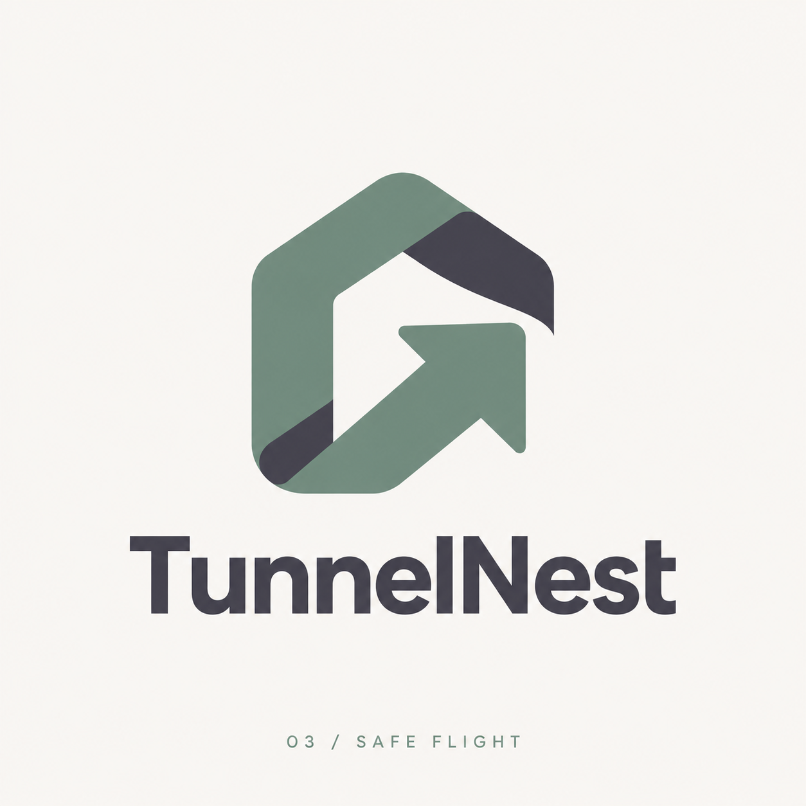

# TunnelNest

TunnelNest is a desktop connection manager for SSH over TLS and V2Ray/Xray tunnels, designed for Windows, Linux, and macOS.

## Selected identity

- **Project name:** TunnelNest
- **Logo:** Safe Flight — concept 03
- **Selected:** 19 October 2026
- **App design:** Soft Workspace — design 3



The Safe Flight symbol combines a home-shaped folded ribbon with an upward-right arrow. The home represents a trusted place for saved connections; the arrow represents a route forward.

## Colors and appearance

- Sage green: `#6F897C` — main logo color.
- Charcoal: `#3F3D4A` — logo contrast and text.
- Warm white: `#F8F6F3` — interface background.
- Muted lavender: `#7D748C` — interface actions and accents.

Use the complete logo for project introductions and documentation. Use the transparent symbol for the app header, app icon, and small placements. Keep its proportions and clear space; avoid stretching or adding effects.

## Logo files

All paths below are relative to this main repository folder.

- [Original Safe Flight presentation](sshTLS-v2ray-tunnel/designs/tunnelnest-logos/03-safe-flight.png)
- [Transparent PNG symbol](sshTLS-v2ray-tunnel/desktop/assets/tunnelnest.png)
- [Windows icon](sshTLS-v2ray-tunnel/desktop/assets/tunnelnest.ico)
- [macOS icon](sshTLS-v2ray-tunnel/desktop/assets/tunnelnest.icns)
- [Embedded interface symbol](sshTLS-v2ray-tunnel/desktop/ui/tunnelnest-mark.png)
- [Selection record and preparation prompt](sshTLS-v2ray-tunnel/designs/tunnelnest-logos/selected-logo.md)

The original concepts and transparent symbol were created with the built-in image generation tool. ICO and ICNS assets are format conversions of the selected symbol. The PNG is a raster asset, not an editable vector master.

## Desktop experience

- Profiles are the opening screen, with search and SSH/V2Ray filters.
- Each profile has Run, Edit, and Delete actions.
- The selected connection card expands to show live tunnel logs.
- The editor uses custom dropdowns and includes SSH credentials, VMess transport settings, TLS version, and certificate options.
- An absent imported SNI stays blank in the editor. The automatic TLS name is displayed separately.
- Saved profiles remain in the existing per-user SQLite database.

## Source and builds

The application source is in [sshTLS-v2ray-tunnel](sshTLS-v2ray-tunnel/). The GitHub repository is [ahmedali-dev/vpn](https://github.com/ahmedali-dev/vpn).

From the source folder:

```sh
python3 scripts/build.py
npm ci --prefix desktop
npm --prefix desktop run package
```

Use `TUNNEL_PACKAGE_TARGET` to build a single target: `win32-x64`, `linux-x64`, `darwin-arm64`, or `darwin-x64`. Packaging requires the appropriate networking cores in `dist/runtime/<target>/cores`; `python3 scripts/fetch-cores.py` downloads and verifies them.

The repository-root [GitHub Actions workflow](.github/workflows/tunnel-release.yml) builds native desktop and CLI archives and publishes releases after the platform jobs pass. Release tags must match `desktop/package.json`, with a corresponding release-notes file.

## Compatibility

The visible application name and logo are TunnelNest. Existing bundle identifiers, SQLite locations, and internal package/archive paths are retained so saved profiles and release scripts continue to work.

The previously published v1.2.2 release predates this branding update. Branding source is maintained on the `codex/release-v1.2.0` branch. A subsequent release is needed to distribute the new branding in downloadable packages.
